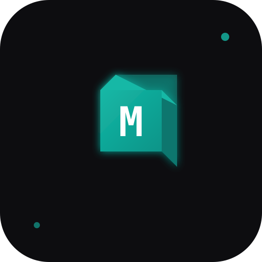

# Modeler

An AI-powered desktop application for generating 3D models from text descriptions and sketches.



## Features

- **Text to 3D**: Generate 3D models from natural language descriptions
- **Sketch to 3D**: Draw or upload sketches and convert them to 3D models
- **Interactive Editing**: Refine models through conversational AI
- **Multi-LLM Support**: Choose from Claude, Azure OpenAI, or Vertex AI
- **STL Export**: Export print-ready files for 3D printing

## Tech Stack

- **Desktop**: Electron
- **Frontend**: React + TypeScript + Vite
- **3D Rendering**: Three.js / React Three Fiber
- **Styling**: Tailwind CSS
- **State Management**: Zustand
- **LLM Providers**: Anthropic Claude, Azure OpenAI, Google Vertex AI
- **3D Generation**: Tripo3D, Meshy

## Getting Started

### Prerequisites

- Node.js 18+
- npm or pnpm

### Installation

```bash
# Install dependencies
npm install

# Start development
npm run electron:dev

# Build for production
npm run electron:build
```

## Configuration

1. Open Settings (gear icon in the title bar)
2. Configure your LLM provider (Claude, Azure, or Vertex)
3. Configure your 3D generation provider (Tripo3D or Meshy)
4. Get API keys from:
   - [Anthropic Console](https://console.anthropic.com/) for Claude
   - [Azure Portal](https://portal.azure.com/) for Azure OpenAI
   - [Google Cloud Console](https://console.cloud.google.com/) for Vertex AI
   - [Tripo3D](https://tripo3d.ai/) for 3D generation
   - [Meshy](https://meshy.ai/) for 3D generation

## Usage

### Text to 3D

1. Select "Text Prompt" mode from the sidebar
2. Enter a description of your 3D model
3. Optionally click "Enhance with AI" to improve the prompt
4. Click "Generate 3D Model"

### Sketch to 3D

1. Select "Sketch" mode from the sidebar
2. Draw your model concept or upload an image
3. Click "Generate from Sketch"

### Editing

1. After generating a model, switch to "Edit" mode
2. Chat with the AI to describe changes
3. Export your final model as STL

## Project Structure

```
modeler/
├── electron/           # Electron main process
├── src/
│   ├── main.tsx       # React entry point
│   ├── App.tsx        # Main app component
│   ├── shared/        # Shared types
│   ├── services/      # API services
│   │   ├── llm/       # LLM providers
│   │   └── generation/# 3D generation APIs
│   └── renderer/
│       ├── components/# React components
│       ├── stores/    # Zustand stores
│       └── hooks/     # Custom hooks
├── public/            # Static assets
└── package.json
```

## License

MIT

