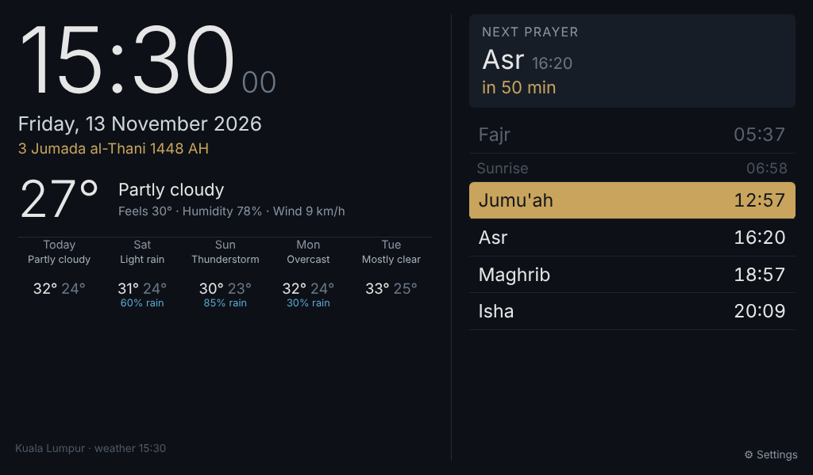

# Kindle Fire home dashboard

A single-file dashboard (`index.html`) with a clock, prayer times, the Hijri date and the weather. It is written in plain ES5 with old-WebKit-safe CSS, so it runs in the Silk browser on old Kindle Fire tablets.

- **Prayer times** are calculated on the tablet itself and work offline. You can choose from 16 calculation methods and Standard or Hanafi Asr, and set per-prayer minute offsets to match your local mosque.
- **Weather** comes from [Open-Meteo](https://open-meteo.com), which needs no API key. It refreshes every 15 minutes, and the last result is cached.
- The Hijri date (tabular calendar, adjustable by ±days) rolls over at Maghrib. Dhuhr shows as Jumu'ah on Fridays.
- There is an optional dimmed screen from Isha + 1h until Fajr.

## Setup on the Kindle
1. Host `index.html` anywhere (GitHub Pages, a home server), or copy it onto the Kindle over USB and open it as a `file:///sdcard/...` URL.
2. On first open, Settings appears. Search for your city or enter its latitude and longitude, then pick a method and tap Save.
3. Set the Kindle's time zone to match the location, because prayer times follow the tablet's clock.
4. Keep the screen on: set Settings → Display → Screen timeout to Never and leave it on the charger. A kiosk browser such as Fully Kiosk Browser can also run it full-screen.

If the browser doesn't keep settings, bookmark the link shown under **Bookmark** in Settings. It holds every option as a URL parameter, for example `index.html?lat=3.139&lon=101.6869&name=Kuala%20Lumpur&method=JAKIM`.
